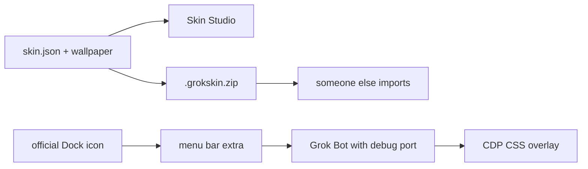

# Grok Bot Skin

**English** | [中文](README.zh-CN.md)

Skin packs and a companion launcher for [Grok Bot](https://grok.com). Packs are data folders. This kit **does not modify** `Grok Bot.app`.

It only restyles the window: CSS tokens plus a wallpaper on `.sand-shell`. Bot avatars stay a Grok Bot feature.

A menu bar extra remembers the last pack and switches among the bundled skins. While that extra is running, the official Dock icon can reopen Grok Bot with the skin (it quits the unsigned-port process, then launches with a loopback debug port). The signed app is never patched.



Unofficial community project. Not affiliated with xAI, Cursor, or any film or anime rights holder. Bundled illustrations are original fan-style art, not official assets. Do not redistribute `Grok Bot.app`.

## Quick start

Needs Node 22+ on macOS.

First time, open the menu bar extra (it also opens Grok Bot and wears the last skin):

```bash
npm run menubar
# or double-click scripts/Show Skin Menu.command
```

In the menu, leave **Open menu bar at login** and **Follow official Dock launches** checked (both default on). Then:

- Official Dock icon: last skin is applied
- Menu bar skin name: switch in place
- **Show usage chip** (on by default): plan percent remaining, or token totals when Grok Bot exposes them. Uncheck to hide.
- **中文** (off by default): switch the menu bar and usage chip to Chinese. English is the default.

Preview packs and export zips:

```bash
npm run studio
# or double-click scripts/Open Skin Studio.command
```

| id | Name | Appearance |
|---|---|---|
| `ink-night` | Ink Night | Dark |
| `straw-sea` | Straw Sea | Light |
| `leaf-warm` | Leaf Warm | Light |
| `avenger-neon` | Avenger Neon | Dark |
| `jade-grove` | Jade Grove | Dark |

## Preview

These shots are the real Grok Bot window. Sidebar names and chat lines are mock English, not a live transcript.

| Ink Night | Straw Sea |
|:---:|:---:|
|  |  |

| Leaf Warm | Avenger Neon |
|:---:|:---:|
|  |  |


State lives in `~/Library/Application Support/grok-bot-skin/`: `active.json` is the last skin, `prefs.json` is Dock-follow, login, usage chip, and language (`en` or `zh`).

Set Grok Bot Settings → Appearance to the Dark or Light value the pack asks for.

## How the chrome is applied

Grok Bot has no official theme API. The launcher adds a loopback debug port (`127.0.0.1:19222`) and injects CSS. It only changes color tokens. It does not rewrite the asar or break the signature.

After a skin is on, a chip above the sidebar avatar shows this cycle’s usage: token totals if the signed-in APIs return them, otherwise **percent used / remaining** on the Grok Bot plan. It does not intercept clicks. Hide it from the menu (**Show usage chip**) or `npx grok-bot-skin usage off`. The chip and menu bar default to English; check **中文** or run `npx grok-bot-skin lang zh`.

| How you open Grok Bot | What happens |
|---|---|
| Menu **Open Grok Bot and wear** | Opens with the last skin; reapplies in place if the debug port is already up |
| Menu bar skin name | Same, and remembers that pack |
| Official Dock icon, menu bar running, follow on | If this launch has no debug port, quit and reopen with the port, then wear |
| Official Dock icon, menu bar off or follow off | Stock official process, no skin |

Turn follow off from the menu, or `npx grok-bot-skin follow off`.

Do not edit `/Applications/Grok Bot.app`. Developer ID, notarization, and `ElectronAsarIntegrity` will fail, and the next official update will overwrite the patch.

## Share a pack

```bash
npx grok-bot-skin pack ink-night
# writes dist/ink-night-1.0.0.grokskin.zip
```

Someone else:

```bash
npx grok-bot-skin import ~/Downloads/ink-night-1.0.0.grokskin.zip
npx grok-bot-skin studio
```

Imported packs go to `~/Library/Application Support/grok-bot-skin/packs/`, not into this repository. A user pack with the same id overrides a bundled one.

## Author a pack

See [docs/authoring.md](docs/authoring.md) ([中文](docs/authoring.zh-CN.md)). Short path:

1. Copy `examples/template/` or any `packs/*`
2. Folder name must match `skin.json` `id`
3. Replace the wallpaper and cover image
4. Edit `chrome.tokens`
5. `npx grok-bot-skin validate packs/my-skin`
6. `npx grok-bot-skin pack my-skin`

## Commands

Daily use is these two:

```bash
npm run menubar   # menu bar, then open Grok Bot with the last skin
npm run studio    # preview and export packs
```

`npm run open` is only a fallback if the menu bar extra is already running and you just want to wear a skin. Pack and import are in the sections above. `npx grok-bot-skin` lists the rest.

## License

Code is [MIT](LICENSE). Bundled and template pack metadata default to [CC BY 4.0](https://creativecommons.org/licenses/by/4.0/). See [CONTRIBUTING.md](CONTRIBUTING.md) and [SECURITY.md](SECURITY.md).
