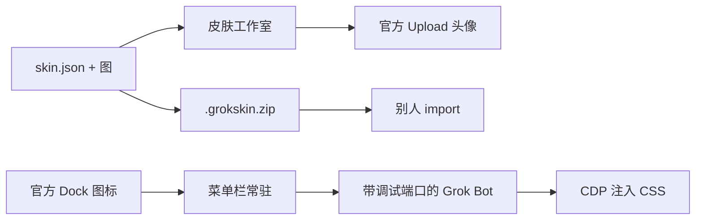

# Grok Bot 皮肤工具

给 Grok Bot 换皮肤，并且让别人也能换。皮肤是独立的数据包，**不修改** `Grok Bot.app`。

两件事分开做：

1. **头像** — 正方形插画，走 Grok Bot 官方 Upload（或 Generate 提示词）。会跟着账号走。
2. **界面** — 覆盖 token，并把壁纸画在窗口层 `.sand-shell` 上。只存在于这次带调试端口的进程里。

日常：菜单栏记住上一套皮肤，五个包来回切。菜单栏在跑时，点官方 Dock 图标也会套上（先退出没带端口的进程，再带端口打开）。官方包本身不动。



## 快速开始

需要 Node 22+。

第一次，打开菜单栏并让它登录时启动：

```bash
npm run menubar
# 或双击 scripts/Show Skin Menu.command
```

菜单栏勾选 **登录时打开菜单栏**、**官方 Dock 打开也套皮肤**（默认都开）。之后：

- 点 Dock 里官方 Grok Bot：会套上上一套皮肤
- 点菜单栏五个名字：原地换肤
- 菜单栏没在跑时，用启动器：`npm run open` 或双击 `scripts/Open Grok Bot.command`

预览、做包、改 token：

```bash
npm run studio
# 或双击 scripts/Open Skin Studio.command
```

| id | 名字 | Appearance |
|---|---|---|
| `ink-night` | 水墨夜 | Dark |
| `paper-dawn` | 宣纸晨 | Light |
| `starlight` | 星光 | Dark |
| `jade-grove` | 青玉林 | Dark |
| `ember-forge` | 熔炉 | Dark |

状态在 `~/Library/Application Support/grok-bot-skin/`：`active.json` 是上一套皮肤，`prefs.json` 是 Dock 跟随和登录启动。

把 Grok Bot 的 Settings → Appearance 调成皮肤要求的 Dark / Light。

## 界面怎么套上

Grok Bot 没有官方主题 API。启动器给进程加上本机回环调试端口（`127.0.0.1:19222`），再注入 CSS。只改 token，不改 asar、不破签名。

| 你怎么打开 | 会怎样 |
|---|---|
| 菜单栏「打开并套上」或 `npm run open` | 用上一套皮肤打开；已在跑且端口开着则原地换肤 |
| 菜单栏五个皮肤名 | 同上，并记住这一套 |
| 官方 Dock 图标，且菜单栏在跑、跟随已开 | 若这次没带端口，会先退出再带端口打开并套上 |
| 官方 Dock 图标，菜单栏没开或跟随已关 | 原样官方进程，界面没皮肤 |

关掉跟随：菜单栏取消勾选，或 `npx grok-bot-skin follow off`。

不要改 `/Applications/Grok Bot.app`：Developer ID 签名、公证、`ElectronAsarIntegrity`，一改就破校验，官方更新也会冲掉。

## 头像（所有人都能用，会同步到手机）

1. 工作室点「套用头像」，或 `npx grok-bot-skin avatar ink-night`
2. 打开对应 Bot 的对话 → 点顶部名字 → 点头像 → **Upload** → 把 Finder 里选中的图拖进去 → **Set avatar**

也可以把皮肤包里的 `bot.generatePrompt` 贴到 **Generate** 页，让 Grok Bot 自己重画一张。

## 分享给别人

```bash
npx grok-bot-skin pack ink-night
# 得到 dist/ink-night-1.0.0.grokskin.zip
```

对方：

```bash
npx grok-bot-skin import ~/Downloads/ink-night-1.0.0.grokskin.zip
npx grok-bot-skin studio
```

导入的包放在 `~/Library/Application Support/grok-bot-skin/packs/`，不污染仓库。同 id 时用户包覆盖自带包。

## 自己做一套皮肤

见 [docs/authoring.md](docs/authoring.md)。最短路径：

1. 复制 `examples/template/` 或任意 `packs/*`
2. 文件夹名与 `skin.json` 的 `id` 一致
3. 换成自己的正方形头像（主体靠中间，圆形裁切也看得清）
4. 改 `chrome.tokens`
5. `npx grok-bot-skin validate packs/my-skin`
6. `npx grok-bot-skin pack my-skin`

## 命令

```
npx grok-bot-skin menubar
npx grok-bot-skin open [id]
npx grok-bot-skin follow on|off
npx grok-bot-skin login on|off
npx grok-bot-skin studio
npx grok-bot-skin list
npx grok-bot-skin status
npx grok-bot-skin apply <id>
npx grok-bot-skin launch [id]
npx grok-bot-skin chrome [id]
npx grok-bot-skin avatar <id>
npx grok-bot-skin clear
npx grok-bot-skin pack <id>
npx grok-bot-skin import <zip>
npx grok-bot-skin validate
npx grok-bot-skin compile [id]
```
