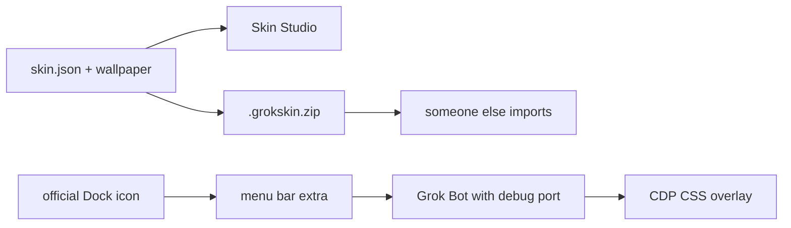

# Grok Bot Skin

**English** | [中文](README.zh-CN.md)

Skin packs for [Grok Bot](https://grok.com), with a menu bar extra and Skin Studio. Packs are folders. This kit **does not modify** `Grok Bot.app`.



Unofficial community project. Not affiliated with xAI, Cursor, or any film or anime rights holder. Bundled illustrations are original fan-style art, not official assets. Do not redistribute `Grok Bot.app`.

## Quick start

Needs Node 22+ on macOS.

```bash
npm run menubar
# or double-click scripts/Show Skin Menu.command
```

```bash
npm run studio
# or double-click scripts/Open Skin Studio.command
```

| id | Name | Appearance |
|---|---|---|
| `ink-night` | Ink Night | Dark |
| `straw-sea` | Straw Sea | Light |
| `leaf-warm` | Leaf Warm | Light |
| `avenger-neon` | Avenger Neon | Dark |
| `jade-grove` | Jade Grove | Dark |

Match Grok Bot Settings → Appearance to the pack. State is in `~/Library/Application Support/grok-bot-skin/`.

## Menu bar

`npm run menubar` puts a palette extra in the macOS menu bar, opens Grok Bot, and wears the last skin.


- Pack name: switch in place
- **Follow official Dock launches**: the official Dock icon also comes back with the last skin (the extra quits the stock process and relaunches with a debug port)
- **Show usage chip**: this cycle’s used / remaining percent, or token totals when Grok Bot exposes them
- **Open menu bar at login**
- **Language → English / 中文**: menu bar, usage chip, Studio, and pack names
- **Skin Studio**: opens the local preview

## Skin Studio

`npm run studio` opens a local page at `http://127.0.0.1:4177/`. Preview tokens and wallpaper, apply chrome, or export a zip.


English / 中文 in the header follows the same language pref as the menu bar.

## Preview

Real Grok Bot window. Sidebar and chat copy are mock English.

| Ink Night | Straw Sea |
|:---:|:---:|
|  |  |

| Leaf Warm | Avenger Neon |
|:---:|:---:|
|  |  |


## How it applies

The launcher adds a loopback debug port (`127.0.0.1:19222`) and injects CSS. Color tokens only — no asar rewrite, no signature break.

| How you open Grok Bot | What happens |
|---|---|
| Menu **Open Grok Bot and wear** | Opens with the last skin; reapplies in place if the debug port is already up |
| Menu bar skin name | Same, and remembers that pack |
| Official Dock icon, menu bar running, follow on | If this launch has no debug port, quit and reopen with the port, then wear |
| Official Dock icon, menu bar off or follow off | Stock official process, no skin |

Do not edit `/Applications/Grok Bot.app`. Developer ID, notarization, and `ElectronAsarIntegrity` will fail, and the next official update will overwrite the patch.

## Author a pack

See [docs/authoring.md](docs/authoring.md) ([中文](docs/authoring.zh-CN.md)). Short path:

1. Copy `examples/template/` or any `packs/*`
2. Folder name must match `skin.json` `id`
3. Replace the wallpaper and cover image
4. Edit `chrome.tokens`
5. `npx grok-bot-skin validate packs/my-skin`
6. `npx grok-bot-skin pack my-skin`

## Share a pack

```bash
npx grok-bot-skin pack ink-night
# writes dist/ink-night-1.0.0.grokskin.zip
```

Someone else:

```bash
npx grok-bot-skin import ~/Downloads/ink-night-1.0.0.grokskin.zip
npx grok-bot-skin studio
```

Imported packs go to `~/Library/Application Support/grok-bot-skin/packs/`. A user pack with the same id overrides a bundled one.

## Commands

Daily use is these two:

```bash
npm run menubar   # menu bar, then open Grok Bot with the last skin
npm run studio    # preview and export packs
```

`npm run open` is only a fallback if the menu bar extra is already running and you just want to wear a skin. `npx grok-bot-skin` lists the rest.

## License

Code is [MIT](LICENSE). Bundled and template pack metadata default to [CC BY 4.0](https://creativecommons.org/licenses/by/4.0/). See [CONTRIBUTING.md](CONTRIBUTING.md) and [SECURITY.md](SECURITY.md).
