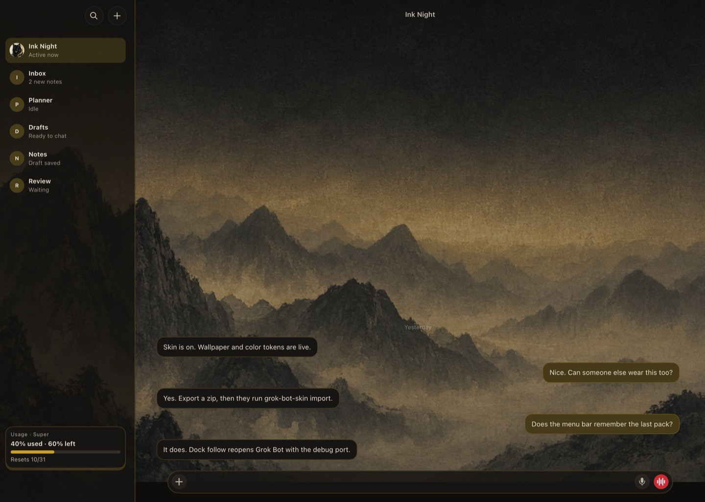
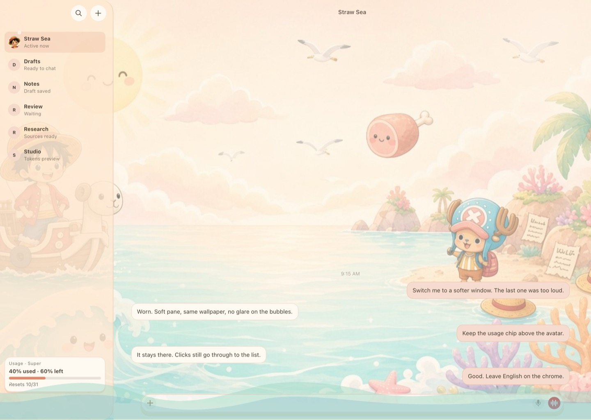
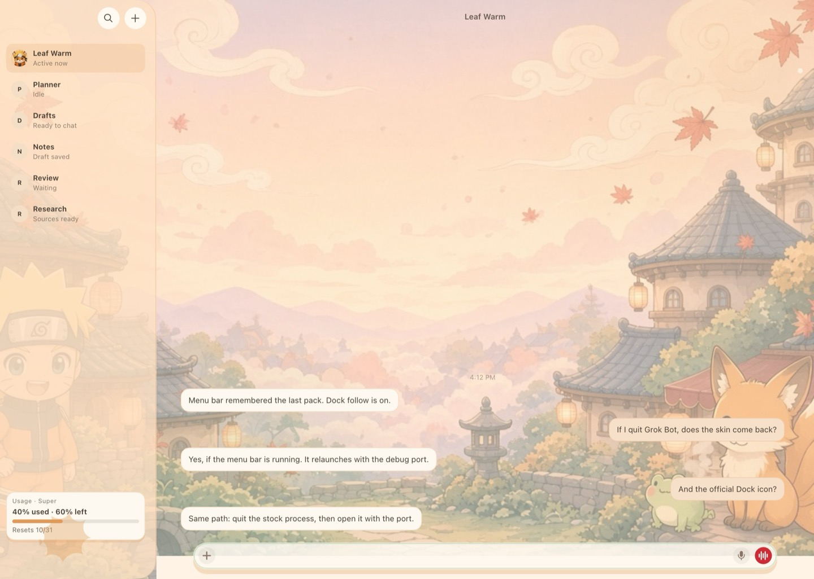
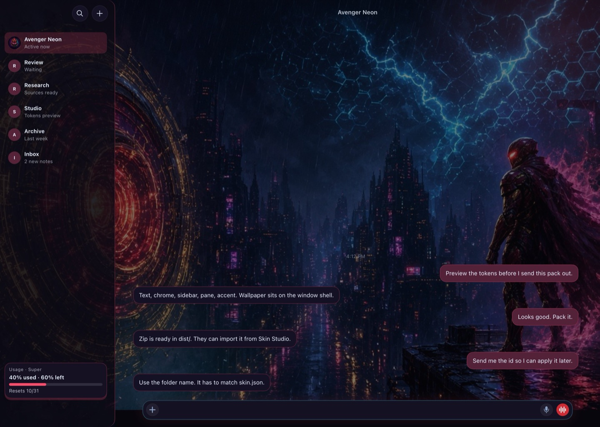
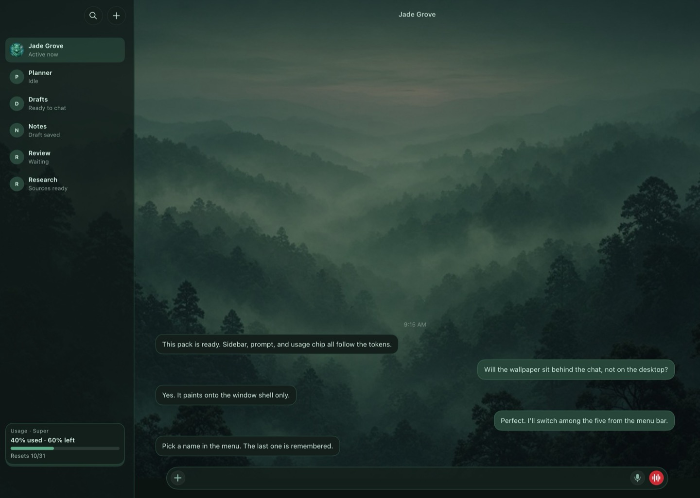
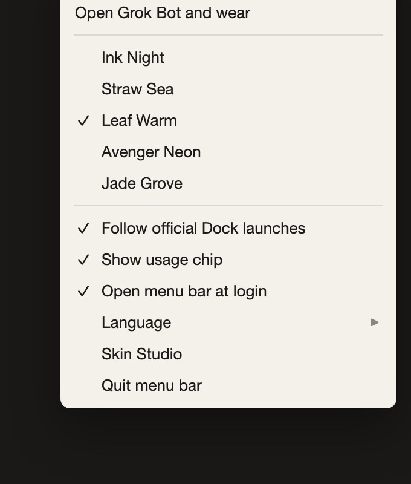
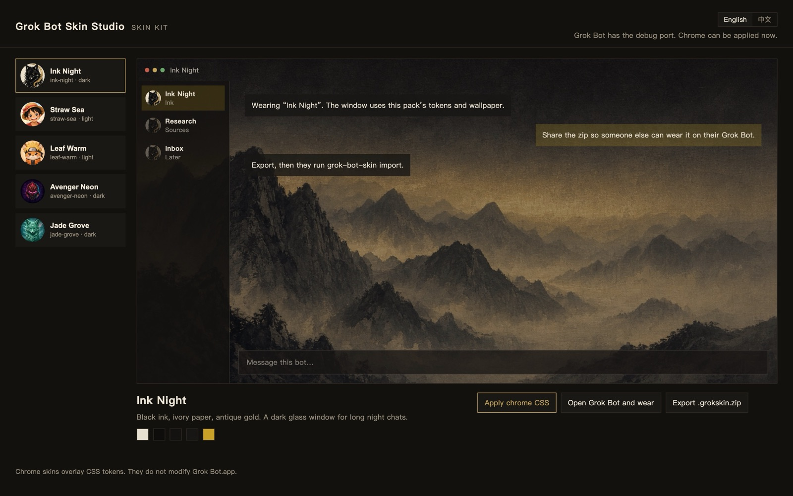

# Grok Bot Skin

**English** | [中文](README.zh-CN.md)

Skins for the macOS [Grok Bot](https://grok.com) app. Switch them from the menu bar. Preview and export them in Skin Studio.

This repository does not include Grok Bot and does not change `Grok Bot.app`.

Unofficial. Not affiliated with xAI or Cursor.

## Screenshots

| Ink Night | Straw Sea |
|:---:|:---:|
|  |  |

| Leaf Warm | Avenger Neon |
|:---:|:---:|
|  |  |

| Jade Grove |
|:---:|
|  |

Ink Night, Avenger Neon, and Jade Grove need **Dark**. Straw Sea and Leaf Warm need **Light**. Set that in Grok Bot → Settings → Appearance.

## Install

macOS, Node 22+, Grok Bot already installed.

```bash
curl -fsSL https://raw.githubusercontent.com/Acropolis/grok-bot-skin/main/scripts/install.sh | bash
```

That copies the kit to `~/Library/Application Support/grok-bot-skin/app` and opens the menu bar. From a checkout, `./scripts/install.sh` (or `scripts/Install Grok Bot Skin.command`) does the same thing.

## Menu bar



- A pack name applies that skin
- **Follow official Dock launches** — opening Grok Bot from the Dock still gets the last skin (the extra restarts the app)
- **Show usage chip** — used / remaining percent for this billing cycle
- **Open menu bar at login**
- **Language → English / 中文**
- **Skin Studio**

Prefs and imported packs: `~/Library/Application Support/grok-bot-skin/`.

## Skin Studio

**Skin Studio** on the menu, or `npm run studio` from a checkout. Opens [http://127.0.0.1:4177/](http://127.0.0.1:4177/). Preview a pack, apply it, or export a `.grokskin.zip`.



## Make a pack

[docs/authoring.md](docs/authoring.md) · [中文](docs/authoring.zh-CN.md)

1. Copy `examples/template/` or any `packs/*`
2. Folder name must match `skin.json` `id`
3. Replace the wallpaper and cover
4. Edit `chrome.tokens`
5. `npx grok-bot-skin validate packs/my-skin`
6. `npx grok-bot-skin pack my-skin`

## Share a pack

```bash
npx grok-bot-skin pack ink-night
# dist/ink-night-1.0.0.grokskin.zip
```

On the other Mac:

```bash
npx grok-bot-skin import ~/Downloads/ink-night-1.0.0.grokskin.zip
npx grok-bot-skin studio
```

Imports go to `~/Library/Application Support/grok-bot-skin/packs/`. Same `id` as a bundled pack: the import wins.

Only import zips you trust.

## How it works

The extra starts Grok Bot with a loopback debug port (`127.0.0.1:19222`) and injects CSS. Opening Grok Bot from the Dock while the extra is quit, or with follow turned off, is the stock window.

Leave `/Applications/Grok Bot.app` alone. `npx grok-bot-skin` lists the other commands.

## License

Code: [MIT](LICENSE).

`ink-night`, `jade-grove`, and `examples/template` (including their illustrations): [CC BY 4.0](https://creativecommons.org/licenses/by/4.0/).

`straw-sea`, `leaf-warm`, and `avenger-neon` are unofficial fan-style packs. Names and likenesses belong to their owners. Those three are not under CC BY.

Do not put `Grok Bot.app` in this repo or in a zip you share.

[CONTRIBUTING.md](CONTRIBUTING.md) · [SECURITY.md](SECURITY.md)
