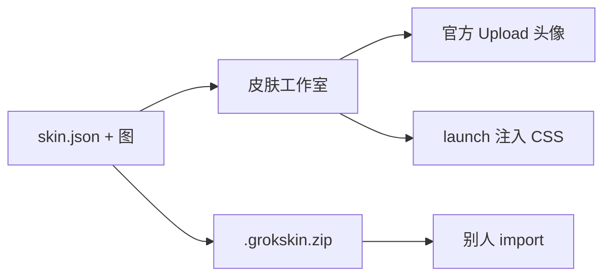

# Grok Bot 皮肤工具

给 Grok Bot 换皮肤，并且让别人也能换。皮肤是独立的数据包，**不修改** `Grok Bot.app`，更新 App 也不会把皮肤冲掉。

做两件事：

1. **头像** — 正方形插画，走 Grok Bot 官方 Upload（或 Generate 提示词）。
2. **界面** — 覆盖 Grok Bot 的 token，并把壁纸画在真正的窗口层 `.sand-shell` 上。



## 快速开始

需要 Node 22+（本机已可）。

```bash
cd grok-bot-skin
npm run studio
```

或双击 `scripts/Open Skin Studio.command`。

工作室里可以预览五套自带皮肤，并把头像送到 Finder。

| id | 名字 | Appearance |
|---|---|---|
| `ink-night` | 水墨夜 | Dark |
| `paper-dawn` | 宣纸晨 | Light |
| `starlight` | 星光 | Dark |
| `jade-grove` | 青玉林 | Dark |
| `ember-forge` | 熔炉 | Dark |

## 套到自己的 Grok Bot 上

### 头像（所有人都能用，会同步到手机）

1. 工作室点「套用头像」，或 `npx grok-bot-skin avatar ink-night`
2. 打开对应 Bot 的对话 → 点顶部名字 → 点头像 → **Upload** → 把 Finder 里选中的图拖进去 → **Set avatar**

也可以把皮肤包里的 `bot.generatePrompt` 贴到 **Generate** 页，让 Grok Bot 自己重画一张。

### 界面颜色和壁纸（本机 CSS 覆盖）

Grok Bot 没有官方主题 API。本工具用 Chromium 调试端口注入一份 CSS，只改 token，不改 asar、不破签名。

```bash
# 先完全退出 Grok Bot，再：
npx grok-bot-skin launch ink-night
```

或在工作室点「启动 Grok Bot 并套上界面」。

把 Settings → Appearance 调成皮肤要求的 Dark / Light。重启 Grok Bot 后界面皮肤会掉，再 `launch` 一次即可。头像是账号数据，不会掉。

## 分享给别人

```bash
npx grok-bot-skin pack ink-night
# 得到 dist/ink-night-1.0.0.grokskin.zip
```

对方：

```bash
npx grok-bot-skin import ~/Downloads/ink-night-1.0.0.grokskin.zip
npx grok-bot-skin studio
```

导入的包放在 `~/Library/Application Support/grok-bot-skin/packs/`，不污染仓库。同 id 时用户包覆盖自带包。

## 自己做一套皮肤

见 [docs/authoring.md](docs/authoring.md)。最短路径：

1. 复制 `examples/template/` 或任意 `packs/*`
2. 文件夹名与 `skin.json` 的 `id` 一致
3. 换成自己的正方形头像（主体靠中间，圆形裁切也看得清）
4. 改 `chrome.tokens`
5. `npx grok-bot-skin validate packs/my-skin`
6. `npx grok-bot-skin pack my-skin`

## 命令

```
npx grok-bot-skin studio
npx grok-bot-skin list
npx grok-bot-skin apply <id>
npx grok-bot-skin launch <id>
npx grok-bot-skin avatar <id>
npx grok-bot-skin chrome <id>
npx grok-bot-skin clear
npx grok-bot-skin pack <id>
npx grok-bot-skin import <zip>
npx grok-bot-skin validate
```

## 为什么不改 Grok Bot.app

应用带 `ElectronAsarIntegrity` 和代码签名。改 asar 会破校验，也没法跟着官方更新走。皮肤包 + 官方头像上传 + 可选 CSS 覆盖，才是可维护、可分发的做法。
