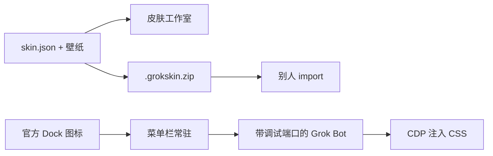

# Grok Bot 皮肤工具

[English](README.md) | **中文**

给 [Grok Bot](https://grok.com) 换皮肤：菜单栏切换，工作室预览和导出。皮肤是文件夹，**不修改** `Grok Bot.app`。



非官方社区项目，与 xAI、Cursor 及任何影视或动漫版权方无关。自带插画是粉丝向原创，不是官方素材。不要再分发 `Grok Bot.app`。

## 快速开始

需要 Node 22+，macOS。

```bash
npm run menubar
# 或双击 scripts/Show Skin Menu.command
```

```bash
npm run studio
# 或双击 scripts/Open Skin Studio.command
```

| id | 名字 | Appearance |
|---|---|---|
| `ink-night` | 水墨夜 | Dark |
| `straw-sea` | 草帽海 | Light |
| `leaf-warm` | 木叶暖 | Light |
| `avenger-neon` | 复联霓 | Dark |
| `jade-grove` | 青玉林 | Dark |

把 Grok Bot 的 Settings → Appearance 调成皮肤要求的 Dark / Light。状态在 `~/Library/Application Support/grok-bot-skin/`。

## 菜单栏

`npm run menubar` 会在菜单栏放一个调色盘，并打开 Grok Bot、套上上一套皮肤。


- 点皮肤名：原地换肤
- **官方 Dock 打开也套皮肤**：官方 Dock 图标也会带上上一套皮肤（先退出没带端口的进程，再带端口打开）
- **显示订阅用量**：本周期已用 / 剩余百分比；接口给 token 时显示消耗
- **登录时打开菜单栏**
- **语言 → English / 中文**：菜单栏、用量卡片、工作室和皮肤名一起切
- **皮肤工作室**：打开本地预览页

## 皮肤工作室

`npm run studio` 打开 `http://127.0.0.1:4177/`。预览 token 和壁纸，套界面，或导出 zip。


右上角 English / 中文 和菜单栏用同一份语言设置。

## 预览

真实 Grok Bot 窗口。侧栏和聊天是英文示意。

| 水墨夜 | 草帽海 |
|:---:|:---:|
|  |  |

| 木叶暖 | 复联霓 |
|:---:|:---:|
|  |  |


## 界面怎么套上

启动器给进程加上本机回环调试端口（`127.0.0.1:19222`），再注入 CSS。只改颜色变量，不改 asar、不破签名。

| 你怎么打开 | 会怎样 |
|---|---|
| 菜单栏「打开并套上」 | 用上一套皮肤打开；已在跑且端口开着则原地换肤 |
| 菜单栏皮肤名 | 同上，并记住这一套 |
| 官方 Dock 图标，且菜单栏在跑、跟随已开 | 若这次没带端口，会先退出再带端口打开并套上 |
| 官方 Dock 图标，菜单栏没开或跟随已关 | 原样官方进程，界面没皮肤 |

不要改 `/Applications/Grok Bot.app`：Developer ID 签名、公证、`ElectronAsarIntegrity`，一改就破校验，官方更新也会冲掉。

## 自己做一套皮肤

见 [docs/authoring.zh-CN.md](docs/authoring.zh-CN.md)（[English](docs/authoring.md)）。最短路径：

1. 复制 `examples/template/` 或任意 `packs/*`
2. 文件夹名与 `skin.json` 的 `id` 一致
3. 换成自己的壁纸和封面图
4. 改 `chrome.tokens`
5. `npx grok-bot-skin validate packs/my-skin`
6. `npx grok-bot-skin pack my-skin`

## 分享给别人

```bash
npx grok-bot-skin pack ink-night
# 得到 dist/ink-night-1.0.0.grokskin.zip
```

对方：

```bash
npx grok-bot-skin import ~/Downloads/ink-night-1.0.0.grokskin.zip
npx grok-bot-skin studio
```

导入的包在 `~/Library/Application Support/grok-bot-skin/packs/`。同 id 时用户包覆盖自带包。

## 命令

日常只用这两个：

```bash
npm run menubar   # 菜单栏，并打开 Grok Bot 套上上一套皮肤
npm run studio    # 预览、做包
```

`npm run open` 只在菜单栏已经在跑、只想再套一次皮肤时用。其余给调试用，`npx grok-bot-skin` 会列出。

## 许可

代码为 [MIT](LICENSE)。自带包和模板的元数据默认 [CC BY 4.0](https://creativecommons.org/licenses/by/4.0/)。另见 [CONTRIBUTING.md](CONTRIBUTING.md) 与 [SECURITY.md](SECURITY.md)。
